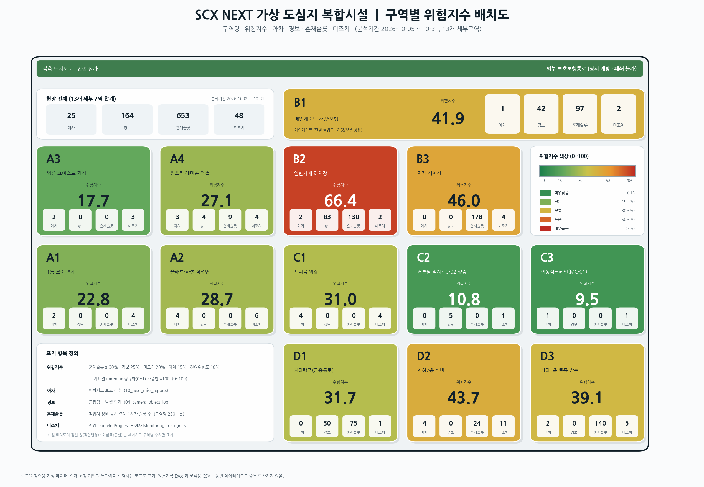

# SCX NEXT v1.4.3 — 구역별 위험지수 배치도

원 배치도(북측 도시도로 / 상가 전면)에서 **점선 원(작업반경 중첩)·화살표(동선 흐름)·점선 경계·범례선을 모두 제거**하고,
13개 세부구역(A1–A4, B1–B3, C1–C3, D1–D3) 박스에 **구역명 / 위험지수 / 아차 / 경보 / 혼재슬롯 / 미조치** 6개 항목만 표기한 배치도.



## 산출물

| 파일 | 내용 |
|---|---|
| `out/risk_map.png` | 최종 배치도 이미지 (보고서 삽입용) |
| `out/risk_map.svg` | 벡터 원본 (PPT/Illustrator 편집용) |
| `out/zone_metrics.csv` | 구역별 지표·위험지수 원장 |
| `out/metrics_detail.json` | 가중치·총계·구역별 상세 |

## 지표 정의 (분석기간 2026-10-05 ~ 10-31, 13개 구역)

| 지표 | 정의 | 원천 |
|---|---|---|
| **아차** | 아차사고 보고 건수 | `10_near_miss_reports.csv` |
| **경보** | 근접경보(Proximity_Alert_Count) 합계 | `04_camera_object_log.csv` |
| **혼재** | 작업자>0 **AND** 장비(지게차+굴착기+트럭)>0 인 1시간 슬롯 수 (구역당 230슬롯) | `04_camera_object_log.csv` |
| **미조치** | 점검 Open·In Progress + 아차 Monitoring·In Progress | `09_inspection_action_log.csv`, `10_near_miss_reports.csv` |

## 위험지수 (0~100)

각 지표 min-max 정규화(0~1) 후 가중합 ×100, 소수 1자리.

| 구성 | 혼재슬롯률 | 경보 | 미조치 | 아차사고 | 잔여위험도 |
|---|---|---|---|---|---|
| 가중치 | 30% | 25% | 20% | 15% | 10% |

등급: 매우낮음 <15 · 낮음 15–30 · 보통 30–50 · 높음 50–70 · 매우높음 ≥70

## 결과 요약

| 순위 | 구역 | 위험지수 | 등급 | 주된 동인 |
|---|---|---|---|---|
| 1 | **B2** 자재 하역장 | 66.4 | 높음 | 경보 83, 혼재 57% |
| 2 | **B3** 자재 적치장 | 46.0 | 보통 | 혼재 77%(178슬롯), 미조치 4 |
| 3 | **D2** 지하2층 설비 | 43.7 | 보통 | 미조치 11, 아차 4 |
| 4 | **B1** 메인게이트 | 41.9 | 보통 | 경보 42, 혼재 42% |
| 5 | **D3** 지하3층 토목 | 39.1 | 보통 | 혼재 61%, 미조치 5 |

- **경보 164건의 76%(125건)가 B구역(B1·B2)** — 단일 게이트 + 하역/적치 중첩이 구조적 원인.
- **혼재슬롯 상위 B3(77%)·D3(61%)·B2(57%)** 는 장비·보행 분리가 안 되는 구역.
- **미조치 48건 중 D2 11건** — 설비·토목 병행구간 조치 지연.

## 재생성

```bash
python3 scripts/compute_metrics.py   # data/*.csv → out/zone_metrics.csv
python3 scripts/draw_riskmap.py      # → out/risk_map.png / .svg
```

## 데이터 유의

- 교육·경연용 가상 데이터. 실제 현장·기업·인물과 무관, 협력사는 코드(A~L) 표기.
- 원천기록 Excel과 분석용 CSV는 **동일 데이터**이므로 중복 합산하지 않음.
- 혼재슬롯은 카메라 로그 10개 슬롯/일 × 23일 = 구역당 230슬롯 기준.
