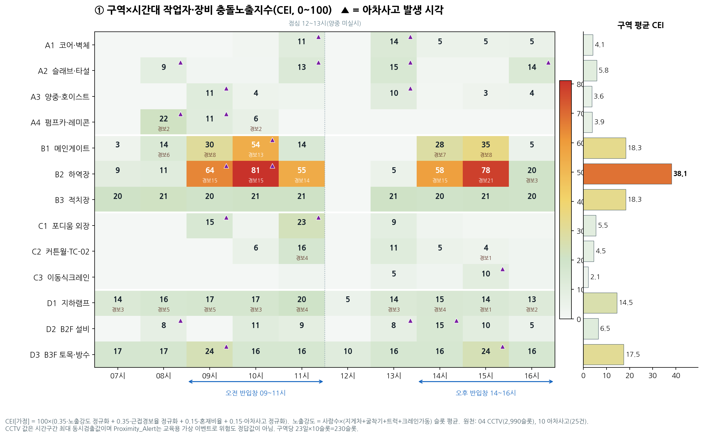
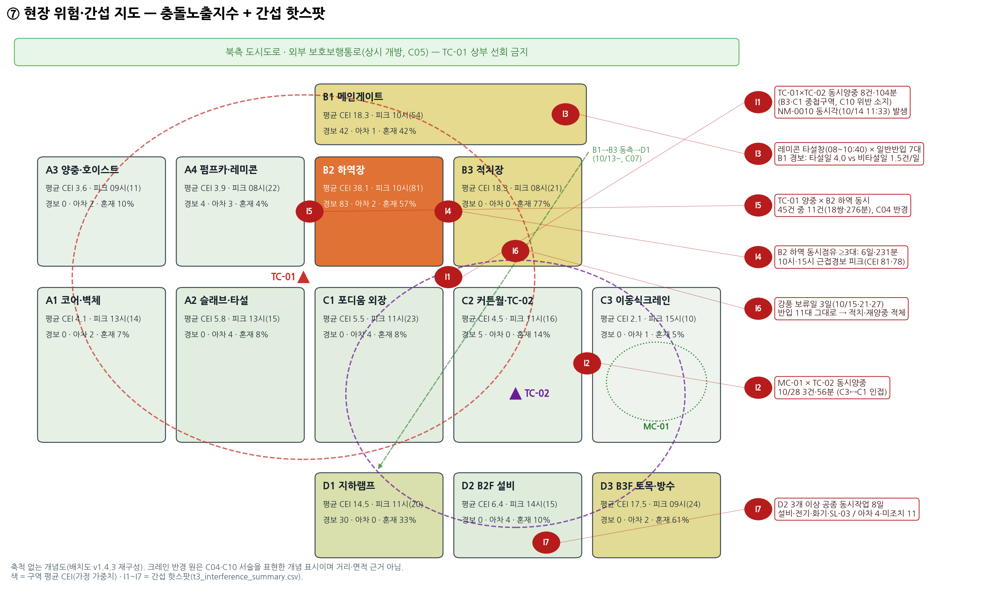
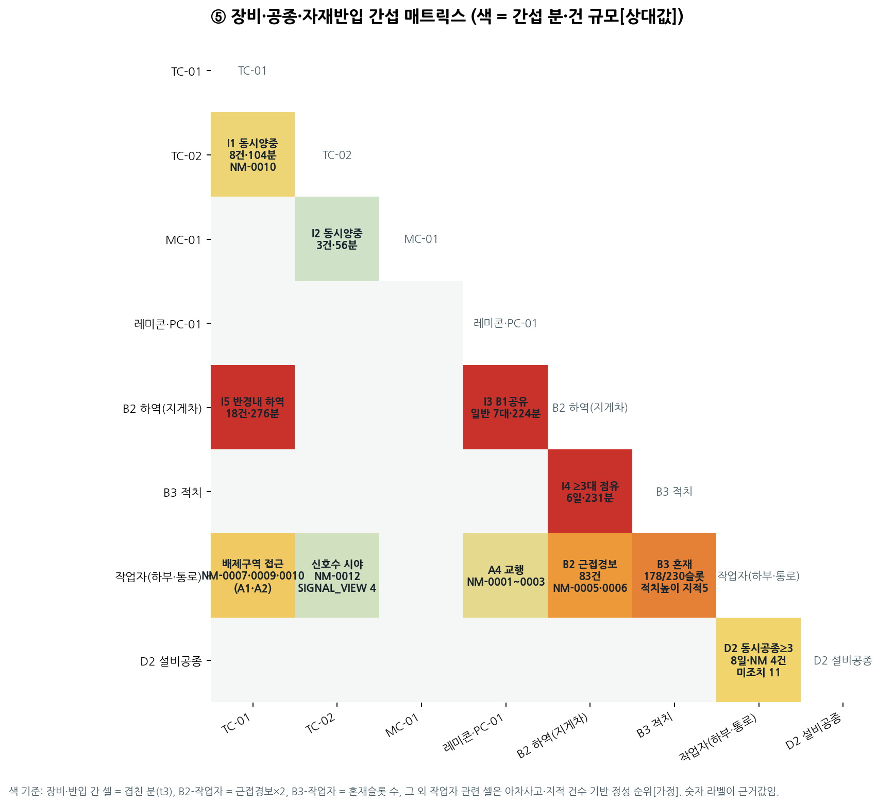
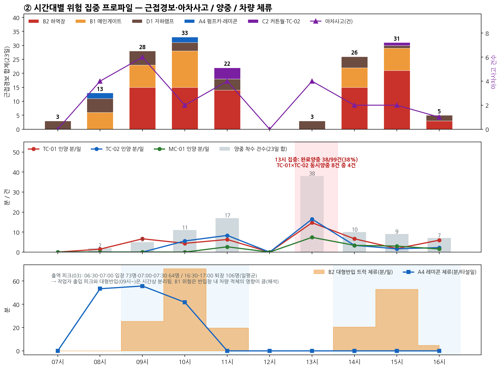
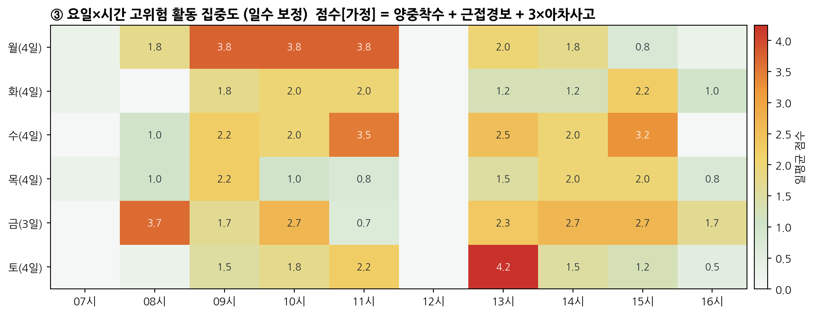
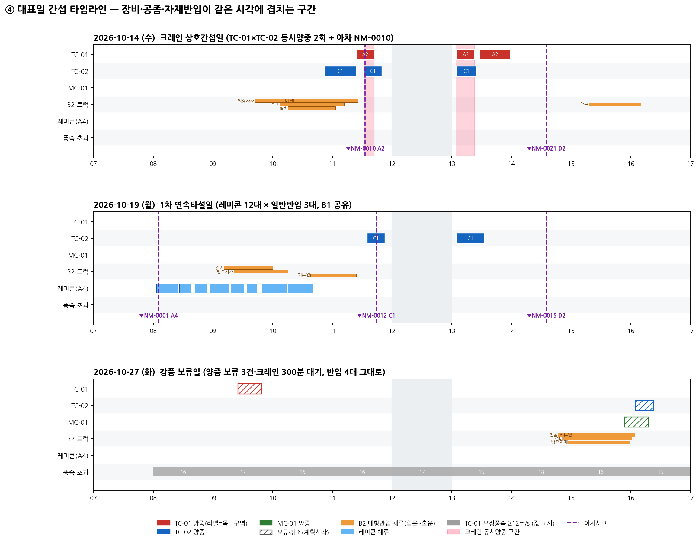
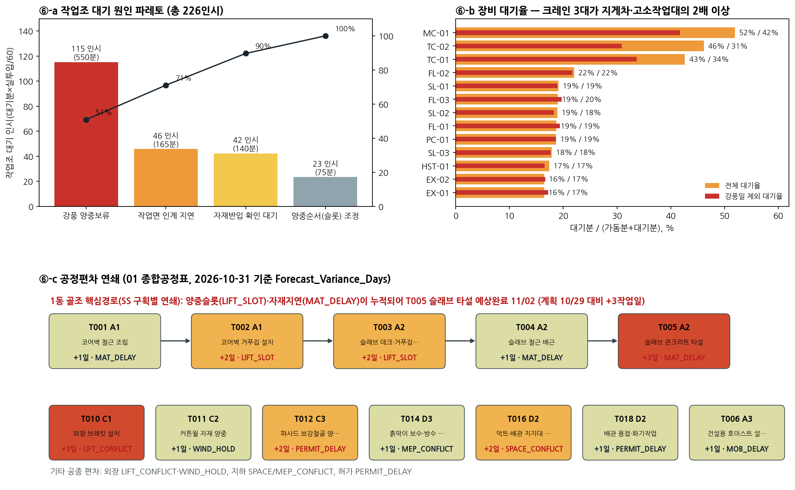

# 미션 2. 위험·간섭구역 분석 결과

- 분석기간: 2026-10-05 ~ 10-31, 작업일 23일 (일요일·10/09 제외)
- 원천: 분석용 CSV(00~18). 통합 Excel·원천기록 Excel은 같은 데이터이므로 **합산하지 않음**
- 재현: `python3 scripts/mission2_analysis.py` → `out/mission2/` (그림 7종, 표 11종, `summary.json`)
- **[가정]** 표시는 분석자가 설정한 값임. 배치도는 축척이 없고, 사진은 정량 근거로 쓰지 않음
- 실제 사람의 안전과 관련된 최종 판단은 현장 관리자가 함

---

## 0. 핵심 결론 (요약)

| # | 결론 | 핵심 근거 |
|---|---|---|
| 1 | 작업자·장비 충돌위험이 가장 높은 곳은 **B2 하역장 10시·15시**와 **B1 메인게이트 10시** | CEI B2 10시 81·15시 78, B1 10시 54. 근접경보 164건 중 **125건(76%)이 B1·B2** |
| 2 | 가장 심각한 장비 간 간섭은 **TC-01×TC-02 동시양중**(C10 금지사항) | 5일 8건 104분. 4건이 13시대에 시작(3건은 13:05). **NM-0010(10/14 11:33)이 동시양중 구간(11:32~11:42) 안에서 발생** |
| 3 | 위험은 요일보다 **시간대**에 몰림 | 양중 착수 38%가 13시에 몰림. 경보는 09~11시·14~15시 반입창에 몰림. 요일별 차이는 작음(일평균 11.5~18.0) |
| 4 | 공정 병목은 **크레인 양중 용량**: 강풍, 슬롯 경합, 작업면 인계 | 작업조 대기 226인시 중 **강풍 51%**. 크레인 대기율 43~52%(지게차 19~22%). 강풍일을 빼도 31~42% |
| 5 | 1동 골조 핵심경로에서 지연이 누적되는 중 | T001 +1 → T002 +2 → T003 +2 → T004 +1 → **T005 +3작업일(예상 완료 11/02)** |

---

## 1. 작업자·장비 충돌 가능성이 높은 구역·시간대

### 1.1 지표 설계: 충돌노출지수 CEI (0~100) [가정]

```
CEI(구역 z, 시간 h) = 100 × ( 0.35·norm(노출강도) + 0.35·norm(근접경보율)
                            + 0.15·혼재비율       + 0.15·norm(아차사고 건수) )
노출강도 = 사람 수 × (지게차 + 굴착기 + 트럭 + 크레인가동)의 슬롯 평균   ← 04 CCTV
혼재비율 = 사람 > 0 이면서 장비 > 0 인 슬롯 비율
```
- 노출강도와 근접경보에 높은 가중치를 둔 이유: 근접경보는 장비 수(지게차+굴착기+트럭)와 상관이 높고(r=0.58), 사람 수와는 거의 상관이 없음(r=0.05). 위험은 사람이 많은 곳보다 **사람과 장비가 섞이는 곳**에서 생긴다는 뜻
- CCTV 값은 구간 내 최대 동시 검출값임. Proximity_Alert는 교육용 가상 이벤트로 정답값이 아님



### 1.2 결과

| 순위 | 구역·시간 | CEI | 근거 |
|---|---|---|---|
| 1 | **B2 10시** | 81.2 | 노출강도 21.9, 경보 15, 혼재 91% |
| 2 | **B2 15시** | 78.1 | 경보 21 (전체 셀 중 최대) |
| 3 | B2 09시 / 14시 / 11시 | 64 / 59 / 55 | 대형반입창(09~11, 14~16)과 일치 |
| 4 | **B1 10시** | 54.2 | 경보 13, 트럭 동시 최대 3대 |
| 5 | D3 09시·15시 | 24 | 굴착기(EX-01)와 작업자가 상시 혼재(61%) |

구역 평균 CEI: B2 38.1 > B1 18.3 = B3 18.3 > D3 17.5 > D1 14.5 > 나머지 7 이하

**구역별 해석**
- **B2·B1 (반입 연동형)**: 근접경보 125건 중 **116건(93%)이 반입창(09~11시·14~15시)**에 생김. 나머지는 08시 6건(B1, 레미콘 타설 시간)과 16시 3건(B2, 하역 마무리). 07시와 점심시간에는 0건. 위험의 원인이 "반입 차량 + 지게차 + 하역 인력"이 한 번에 몰리는 데 있음
- **B3·D3 (상시 혼재형)**: 경보는 0건이지만 혼재율이 각각 77%, 61%로 하루 종일 높음. B3는 적치높이 지적(STACK_HEIGHT)이 5건으로 지적코드 중 공동 1위(WATER_POOL과 동률)이고, D3는 아차사고 2건(굴착기 선회부·후방 사각)이 있음. **경보 데이터만 보면 저평가되는 구역**
- **D1 (단계 전환형, C07)**: 근접경보 30건이 **모두 토목우선 단계(10/05~10/12, 일평균 5.0건)에** 생겼고, 10/13 이후는 0건. 장비 통과동선 전환과 T021 보행통로 설치(10/30 완료)는 효과가 있었던 것으로 보임
- **A4 (타설일 한정형)**: 타설일 3일의 08~10시에만 트럭이 있지만, **3번의 타설 모두에서 아차사고가 났음**(NM-0001~0003). 노출 시간당 사고 밀도가 가장 높은 구역
- **A1·A2·C1 (크레인 하부형)**: CCTV 노출은 낮지만 아차사고가 10건(배제구역 접근, 인양물 하부 이동, 신호수 시야 등). CCTV는 크레인 하부 위험을 잘 잡아내지 못하는 한계가 있음 → 미션3에서 보완할 데이터

---

## 2. 장비·공종·자재 반입 간 간섭구간




| 코드 | 간섭 | 규모 | 관련 제약 | 비고 |
|---|---|---|---|---|
| **I1** | TC-01 × TC-02 동시양중 | **5일 8건·104분** (10/14·17·20·26·30) | C10 중첩구역 동시선회 금지 | 4건이 13시대(3건 13:05). NM-0010 동시 발생 |
| I2 | MC-01 × TC-02 동시양중 | 10/28 3건·56분 | C3↔C1 인접 | |
| **I3** | 레미콘 타설창 × 일반 대형반입 | 타설 3일 모두, 일반트럭 7대·224분 | C02·C09 | B1 경보 타설일 **4.0건/일 vs 비타설일 1.5건/일 (2.7배)** |
| **I4** | B2 하역장 동시점유 ≥3대 | 6일·231분, 최대 4대 (10/14, 10/27) | C08 | 10/15·10/27은 강풍일과 겹침 |
| I5 | TC-01 양중 × B2 하역 동시 | TC-01 완료 45건 중 11건(18쌍·276분) | C04 (반경이 B1·B2에 영향) | 양중 경로 아래로 트럭·지게차가 지나갈 수 있음 |
| I6 | 강풍 양중보류일에 반입 그대로 진행 | 3일(10/15·21·27), 대형반입 11대 | C08 | 양중 보류와 반입 계획이 연동되지 않음 → 적치 체류 증가 |
| I7 | D2 동시 3개 공종 이상 | 8일 (설비·전기·화기 + SL-03·FL-02) | – | 아차 4건, 지적 11건(미조치 7) |

**보조 확인**
- 레미콘 입문간격: 평균 13.3분(목표 12~15분)이지만 33개 간격 중 **15건이 목표를 벗어남**(<12분 7건, >15분 8건)
- 대형반입 예약창(C01): 예약시각이 창 밖인 건과 30분 넘게 조기·지연 도착한 건이 **DL-0001~0004(10/05~06)에 몰려 있음**. ENV-001 민원과 일치. 입문시각은 80건 모두 창 안(현장 밖에서 대기 후 입문)이고, 10/07 이후로는 예약시각 위반이 없음 → 규칙 준수는 좋아졌지만, **창 안에서 차량이 몰리는 문제(I4)는 그대로**
- 작업자 출입 피크(06:30~07:30, 일평균 약 138명 입장)와 대형반입(09시~)은 시간상 분리돼 있음 → B1 위험은 출퇴근 보행자보다 **반입창 안에서 차량이 적체되는 것**의 영향이 큰 것으로 해석됨 (출역 집계에 09~16시 이동이 없어 보행 노출은 추가 검증 필요)
- 작업허가 공백 (확인 필요): 굴착기 가동 20개 일·공정 중 9건이 같은 날 굴착허가가 없음. 지하 고소작업대 SL-03 가동 17일 모두 고소작업 허가가 없음(고소허가는 C1 T010에만 발행됨). 허가 대상인지는 현장 기준 확인 필요 [가정]

---

## 3. 위험작업 집중 시간·구역 시각화



- **오전 09~11시**: 근접경보 피크(10시 33건) + 레미콘(08~10:40) + 대형반입 1창. B1·B2·A4 위험이 동시에 생김
- **13시**: 완료 양중 99건 중 **38건(38%)이 13시에 착수**. 점심 후 크레인 3대가 동시에 재개하는 구조 → TC-01×TC-02 동시양중 8건 중 4건이 이 시각. 아차사고도 13시대에 4건
- **14~15시**: 대형반입 2창. B2 15시 경보 21건(셀 최대)



- 요일 보정 일평균 점수는 월·금 18.0 > 수 16.5 > 토 13.3 > 화 11.8 > 목 11.5
- 위험성평가 고위험(초기 ≥15) 작업의 투입 일수는 요일별로 30~38회로 고름 → 초기 징후 "고위험 작업이 특정 요일에 집중"은 **약하게만 지지됨**. 실제 집중은 **시간대(10시·13시·15시)**에서 일어남



대표일 3일에서 간섭이 겹치는 모습을 확인함
- 10/14: 동시양중 2회. 오전 B2 트럭 4대 동시
- 10/19: 레미콘 12대와 일반반입 3대가 B1 공유. NM-0001(A4)
- 10/27: 하루 종일 풍속 초과(TC-01 보정 15~18 m/s). 양중 보류 3건이지만 오후 반입 4대가 동시 진입

---

## 4. 공정대기·작업중단 병목요인



### 4.1 작업조 대기 (02 작업일보, 대기분 × 실투입 인원)
| 원인 | 대기분 | 인시 | 비중 |
|---|---|---|---|
| 강풍 양중보류 | 550 | 115 | **51%** |
| 작업면 인계 지연 | 165 | 46 | 20% |
| 자재반입 확인 대기 | 140 | 42 | 19% |
| 양중순서(슬롯) 조정 | 75 | 23 | 10% |
| **합계** | 930 | **226** | |

- 대기는 모두 **크레인 의존 공정**(A1·A2·A3·C1·C2·C3)에서만 생김. B·D 구역은 대기 0분으로 기록됨
- 공정별로는 A2(T003·T004) 80인시가 1위이고 C3(T012) 43인시가 다음

### 4.2 장비 대기 (07 장비일보)
- 대기율: MC-01 52%, TC-02 46%, TC-01 43% vs 지게차·고소작업대·굴착기 16~22%
- **강풍 3일을 빼도 크레인 대기율은 31~42%** → 날씨가 아닌 구조적 대기가 있음
  - 원인 메모: 작업면 인계 대기, 자재순서 조정, 점검 후 재가동
  - 하역 완료부터 양중 착수까지 중앙값 100~144분. 다음 날 양중 6건 → A3·C2·C3 적치 체류
- 지게차 대기 메모 1위: 작업면 인계 대기 1,256분, 자재순서 조정 1,198분 → B2 하역순서와 크레인 양중순서가 맞물리지 않음

### 4.3 강풍 판단 검증
- 13번 기상자료 × 높이보정계수(TC-01 1.35 / TC-02 1.25 / MC-01 1.15, 사사오입)로 다시 계산한 결과, 양중일지 Wind_mps 113건 **전부 일치**
- 풍속 보류 13건은 모두 기준 초과로 확인됨 → 보류 결정 자체는 적정
- 문제는 **강풍 예상일(10/15·21·27)에 반입·작업조 배치를 미리 조정하지 않은 것**(I6)

### 4.4 공정편차 연쇄 (01 종합공정표, 10/31 기준)
- 1동 골조 SS 연쇄: T001 +1(MAT) → T002 +2(LIFT_SLOT) → T003 +2(LIFT_SLOT) → T004 +1(MAT) → **T005 +3(예상 완료 11/02, 계획 10/29)**
- 지연사유 합계(작업일): MAT_DELAY 5, LIFT_SLOT 4, LIFT_CONFLICT 3(T010), PERMIT_DELAY 3, SPACE/ROUTE/MEP_CONFLICT 5

### 4.5 병목 구조 (원인 → 결과)
```
강풍(3일) ───────┐
크레인 13시 동시재개┼─► 양중 슬롯 부족·경합 ─► 작업조 대기(A·C) ─► LIFT_SLOT/CONFLICT 지연 ─► T005 +3일
반입-양중 순서 불일치┘          │                                     ▲
     │                        └─► 동시양중(I1·I2) → 크레인 하부 아차(NM-0010 등)
     └─► 반입창 내 차량 몰림 ─► B2 동시점유(I4)·B1 적체(I3) ─► 근접경보 76% 집중
```

---

## 5. 안전관리 이행 보조지표 (미션1·3 연계)
- 점검 지적 52건: 미종결 29건, 기한 초과 35건, 재발 15건. **D2가 11건(미종결 7)으로 최다**
- TBM 미참석(실투입 − 참석) 164명·일: D2 36, C2 25, B1 19, B3 17 → 위험 구역과 겹침

## 6. 데이터 품질·정제 기준
| 이슈 | 처리 |
|---|---|
| 반입 문서번호 중복 (SRC-D-0077: DL-0077·DL-0080) | 업무 ID가 다르므로 두 건 모두 유지 (안내서 기준) |
| DL-0079 Unload_End 결측 | 하역시간 통계에서만 제외. 체류(입문~출문)는 포함 |
| 예약시각이 창 밖인 건 / 30분 넘게 조기·지연 도착 (DL-0001~0004) | 규칙 예외로 보고 유지. 지표로 별도 집계 |
| 양중 보류 13건·취소 1건 | 인양 실적·동시양중 분석에서 제외. 보류 분석에만 사용 |
| 점검 ID와 발행시각 순서 불일치, Closed 결측 29건 | 발행시각 기준으로 정렬. 결측은 미종결로 처리 |
| CCTV 최대 동시값 | 누적 대수로 해석하지 않음. B1의 현장 외 대기 차량은 화각 밖 |

## 7. 한계와 추가로 필요한 데이터
- CCTV는 1시간 집계값이라 크레인 하부와 인양 경로 아래의 노출을 잡지 못함 → 크레인 훅 위치·배제구역 출입 이벤트 데이터가 필요
- 크레인 반경과 중첩 범위는 축척 없는 개념도 기준임. 실제 중첩 여부는 선회각 로그로 확인해야 함
- CEI 가중치와 요일 점수의 아차사고 가중 3은 분석 목적에 맞춰 설정한 **가정**임 (민감도 분석은 미션3에서 수행 예정)
